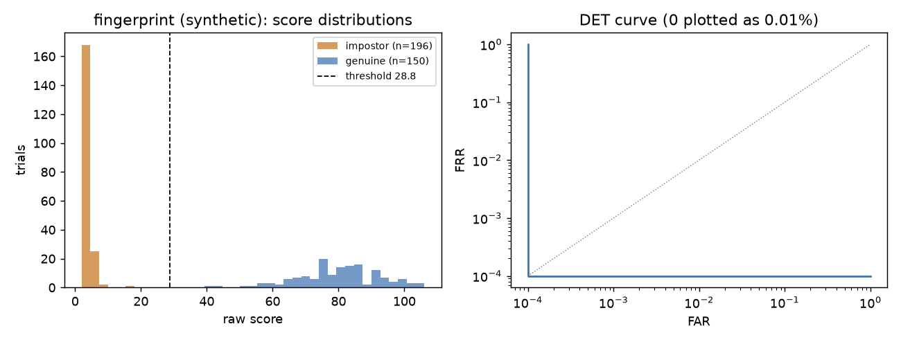
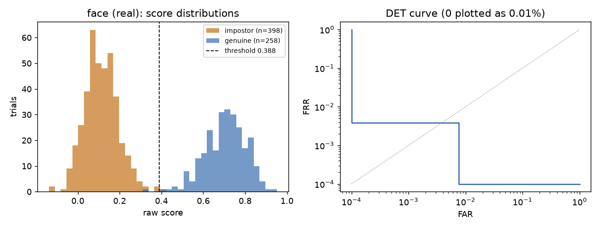
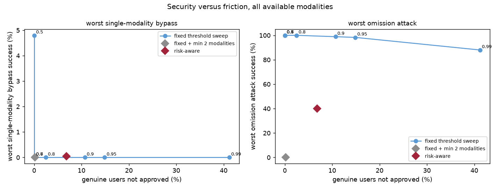

# TriLock evaluation report

Generated by `python -m app.evaluation.report` from the stored runs. Do not edit by hand.

## Individual modules

| Module | Data | Subjects (eval half) | Genuine / impostor trials | Threshold | EER | FAR (95% CI) | FRR (95% CI) | FAR over splits | FRR over splits | Not evaluable | Mean / p95 latency (ms) |
|---|---|---|---|---|---|---|---|---|---|---|---|
| voice | real: data/datasets/librispeech/LibriSpeech/dev-clean-2 | 13 | 65 / 53 | 0.4542 | 0.00% | 0.00% (0.0% to 6.9%) | 3.12% (0.9% to 10.7%) | 1.37% ± 1.84% | 0.78% ± 1.10% | 1.7% | 883.6 / 1879.7 |
| fingerprint | SYNTHETIC: synthetic fingerprints (100 identities x 4 impressions) | 50 | 150 / 196 | 28.7811 | 0.00% | 0.00% (0.0% to 1.9%) | 0.00% (0.0% to 2.5%) | 0.00% ± 0.00% | 0.00% ± 0.00% | 0.0% | 29.3 / 46.5 |
| face | real: data/datasets/lfw/lfw_funneled | 127 | 283 / 420 | 0.3884 | 0.45% | 0.50% (0.1% to 1.8%) | 0.39% (0.1% to 2.2%) | 0.25% ± 0.17% | 0.55% ± 0.33% | 6.7% | 13.8 / 20.0 |

Thresholds are fitted on a calibration half of the subjects that is disjoint from the evaluation half. Intervals are Wilson intervals that assume independent trials; trials reuse the same subjects so they are optimistic. 'Over splits' is the mean ± sd of 10 random calibration/evaluation splits.


Run details for voice: enrolled subjects 26 (enrollment failures 0), 338 trials scored, cross-session share of genuine probes 38%, trial manifest `07ae76dc048f494a`, seed 1.



Run details for fingerprint: enrolled subjects 100 (enrollment failures 0), 1100 trials scored, cross-session share of genuine probes 0%, trial manifest `17689b27a3064f43`, seed 1.



Run details for face: enrolled subjects 253 (enrollment failures 47), 2260 trials scored, cross-session share of genuine probes 0%, trial manifest `93523105cb1d5c04`, seed 1.

## Degraded inputs (single module)

| Module | Condition | Trials | FAR | FRR | Not evaluable |
|---|---|---|---|---|---|
| voice | noise SNR 10 dB | 60 | 0.00% | 13.79% | 6.7% |
| voice | noise SNR 0 dB | 60 | 0.00% | n/a | 98.3% |
| voice | only 1 s of audio | 60 | n/a | n/a | 100.0% |
| fingerprint (synthetic) | half occluded | 150 | 0.00% | 18.03% | 7.3% |
| fingerprint (synthetic) | heavy noise (sigma 40) | 150 | 0.00% | 100.00% | 0.0% |
| face | mild blur (sigma 1.5) | 200 | 1.35% | 0.00% | 34.5% |
| face | strong blur (sigma 4) | 200 | n/a | n/a | 100.0% |
| face | dim light (x0.4) | 200 | 0.00% | 0.00% | 68.0% |
| face | very dark (x0.18) | 200 | n/a | n/a | 100.0% |
| face | half resolution, JPEG q30 | 200 | n/a | n/a | 100.0% |
| face | 1/5 resolution, JPEG q15 | 200 | n/a | n/a | 100.0% |

## Fixed-threshold vs risk-aware fusion

Data: **includes SYNTHETIC scores**; sources: face: data/datasets/lfw/lfw_funneled; fingerprint: synthetic fingerprints (100 identities x 4 impressions); voice: data/datasets/librispeech/LibriSpeech/dev-clean-2.
1000 attempts per scenario and risk level, 5 repeats. Score pools (evaluation half): face 283 genuine / 420 impostor, fingerprint 150 genuine / 196 impostor, voice 65 genuine / 53 impostor.
Assumed risk mix: {'low': 0.4, 'medium': 0.3, 'high': 0.2, 'critical': 0.1}. All policies are scored on identical attempts.

| Condition | Policy | FAR (zero effort) | FRR | Genuine asked for more | Worst bypass | Worst omission attack |
|---|---|---|---|---|---|---|
| all available modalities | fixed | 0.00% (0.0% to 6.8%) | 0.06% (0.0% to 6.8%) | 0.0% | 0.1% | 100.0% |
| all available modalities | fixed + min 2 modalities | 0.00% (0.0% to 6.8%) | 0.06% (0.0% to 6.8%) | 0.1% | 0.0% | 0.0% |
| all available modalities | risk-aware | 0.00% (0.0% to 6.8%) | 0.00% (0.0% to 6.8%) | 6.8% | 0.0% | 40.0% |
| face missing | fixed | 0.00% (0.0% to 6.8%) | 1.72% (0.3% to 9.9%) | 0.0% | 2.0% | 100.0% |
| face missing | fixed + min 2 modalities | 0.00% (0.0% to 6.8%) | 1.72% (0.3% to 9.9%) | 1.7% | 0.0% | 0.0% |
| face missing | risk-aware | 0.00% (0.0% to 6.8%) | 0.00% (0.0% to 6.8%) | 32.8% | 0.9% | 40.0% |
| fingerprint missing | fixed | 0.00% (0.0% to 6.8%) | 3.32% (1.0% to 12.8%) | 0.2% | 5.2% | 91.2% |
| fingerprint missing | fixed + min 2 modalities | 0.00% (0.0% to 6.8%) | 3.32% (1.0% to 12.8%) | 10.3% | 0.7% | 0.0% |
| fingerprint missing | risk-aware | 0.00% (0.0% to 6.8%) | 0.14% (0.0% to 6.8%) | 10.8% | 2.6% | 38.0% |
| voice missing | fixed | 0.00% (0.0% to 2.5%) | 0.34% (0.1% to 3.7%) | 0.0% | 6.0% | 100.0% |
| voice missing | fixed + min 2 modalities | 0.00% (0.0% to 2.5%) | 0.34% (0.1% to 3.7%) | 9.1% | 0.7% | 0.0% |
| voice missing | risk-aware | 0.00% (0.0% to 2.5%) | 0.00% (0.0% to 2.5%) | 33.2% | 2.4% | 40.0% |
| only face | fixed | 0.00% (0.0% to 1.3%) | 0.64% (0.2% to 2.5%) | 8.3% | 90.1% | n/a |
| only face | fixed + min 2 modalities | 0.00% (0.0% to 1.3%) | 0.64% (0.2% to 2.5%) | 99.4% | 0.0% | n/a |
| only face | risk-aware | 0.00% (0.0% to 1.3%) | 0.36% (0.1% to 2.0%) | 63.2% | 36.4% | n/a |
| only fingerprint | fixed | 0.00% (0.0% to 2.5%) | 0.00% (0.0% to 2.5%) | 0.0% | 100.0% | n/a |
| only fingerprint | fixed + min 2 modalities | 0.00% (0.0% to 2.5%) | 0.00% (0.0% to 2.5%) | 100.0% | 0.0% | n/a |
| only fingerprint | risk-aware | 0.00% (0.0% to 2.5%) | 0.00% (0.0% to 2.5%) | 60.0% | 40.0% | n/a |
| only voice | fixed | 0.00% (0.0% to 6.8%) | 9.91% (4.1% to 20.3%) | 1.4% | 88.5% | n/a |
| only voice | fixed + min 2 modalities | 0.00% (0.0% to 6.8%) | 9.91% (4.1% to 20.3%) | 90.1% | 0.0% | n/a |
| only voice | risk-aware | 0.00% (0.0% to 6.8%) | 1.13% (0.3% to 9.9%) | 61.4% | 37.3% | n/a |
| all modalities degraded | fixed | 0.00% (0.0% to 12.1%) | 19.67% (10.2% to 39.5%) | 0.2% | 2.3% | 73.3% |
| all modalities degraded | fixed + min 2 modalities | 0.00% (0.0% to 12.1%) | 19.67% (10.2% to 39.5%) | 4.1% | 0.0% | 0.0% |
| all modalities degraded | risk-aware | 0.00% (0.0% to 12.1%) | 1.46% (0.0% to 12.1%) | 38.6% | 0.9% | 31.9% |




### Per risk level, all available modalities

| Risk | Policy | FAR | FRR | Genuine asked for more | Worst bypass | Worst omission attack |
|---|---|---|---|---|---|---|
| low | fixed | 0.00% | 0.00% | 0.0% | 0.1% | 100.0% |
| low | fixed + min 2 modalities | 0.00% | 0.00% | 0.1% | 0.0% | 0.0% |
| low | risk-aware | 0.00% | 0.00% | 2.7% | 0.1% | 100.0% |
| medium | fixed | 0.00% | 0.00% | 0.0% | 0.0% | 100.0% |
| medium | fixed + min 2 modalities | 0.00% | 0.00% | 0.1% | 0.0% | 0.0% |
| medium | risk-aware | 0.00% | 0.00% | 3.7% | 0.0% | 0.0% |
| high | fixed | 0.00% | 0.20% | 0.0% | 0.0% | 100.0% |
| high | fixed + min 2 modalities | 0.00% | 0.20% | 0.1% | 0.0% | 0.0% |
| high | risk-aware | 0.00% | 0.00% | 13.8% | 0.0% | 0.0% |
| critical | fixed | 0.00% | 0.20% | 0.0% | 0.1% | 100.0% |
| critical | fixed + min 2 modalities | 0.00% | 0.20% | 0.1% | 0.0% | 0.0% |
| critical | risk-aware | 0.00% | 0.00% | 18.8% | 0.0% | 0.0% |

Decision thresholds used:

```json
{
 "fixed_threshold": 0.7,
 "weights": {
  "face": 1.0,
  "fingerprint": 1.0,
  "voice": 1.0
 },
 "bands": {
  "low": {
   "approve": 0.6,
   "reject": 0.3,
   "min_modalities": 1,
   "min_coverage": 0.3,
   "conflict_floor": 0.5,
   "require_core": false
  },
  "medium": {
   "approve": 0.7,
   "reject": 0.35,
   "min_modalities": 2,
   "min_coverage": 0.5,
   "conflict_floor": 0.5,
   "require_core": false
  },
  "high": {
   "approve": 0.8,
   "reject": 0.4,
   "min_modalities": 2,
   "min_coverage": 0.6,
   "conflict_floor": 0.5,
   "require_core": true
  },
  "critical": {
   "approve": 0.88,
   "reject": 0.45,
   "min_modalities": 2,
   "min_coverage": 0.7,
   "conflict_floor": 0.5,
   "require_core": true
  }
 }
}
```

Reproduce: `/home/uravity/trilock/backend/app/evaluation/run_fusion.py` (seed 7).

## Liveness checks

No spoofing dataset was available. Face attacks are SIMULATED from LFW stills; voice uses real speech but only tests the content check. See docs/EVALUATION.md for what this does and does not show.

Face head-turn check, 250 LFW people, thresholds {'yaw_min': 0.25, 'parallax_min': 0.15, 'max_step_fraction': 0.7}:

| Scenario | Passed |
|---|---|
| Flat photo tilted in front of the camera (simulated, smooth ramp) | 1/1000 = 0.10% (0.0% to 0.6%) |
| Two real photos shown one after the other (frontal then turned) | 0/192 = 0.00% (0.0% to 2.0%) |
| Real-turn proxy: different photos of one person, parallax test only | 192/192 = 100.00% (98.0% to 100.0%) |

Result codes for the tilt attack: {'no_head_turn': 985, 'wrong_direction': 2, 'face_lost': 12, 'passed': 1}. For the swap attack: {'abrupt_change': 192}.

Spoken-word check, 130 real utterances from 26 speakers (challenge words taken from each transcript):

| Required words | Said, clean | Said, 10 dB noise | Said, 0 dB noise | Unrelated recording |
|---|---|---|---|---|
| 3 of 3 | 102/130 = 78.46% (70.6% to 84.7%) | 70/130 = 53.85% (45.3% to 62.2%) | 17/130 = 13.08% (8.3% to 19.9%) | 0/650 = 0.00% (0.0% to 0.6%) |
| 2 of 3 | 124/130 = 95.38% (90.3% to 97.9%) | 118/130 = 90.77% (84.6% to 94.6%) | 63/130 = 48.46% (40.0% to 57.0%) | 0/650 = 0.00% (0.0% to 0.6%) |

Chance that unrelated speech contains three random words of the project vocabulary: 0/3000 = 0.00% (0.0% to 0.1%).
