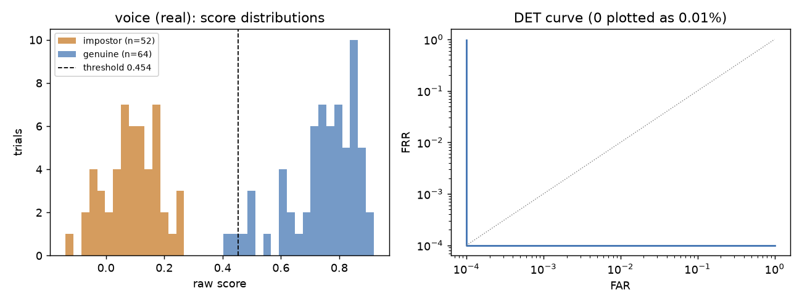
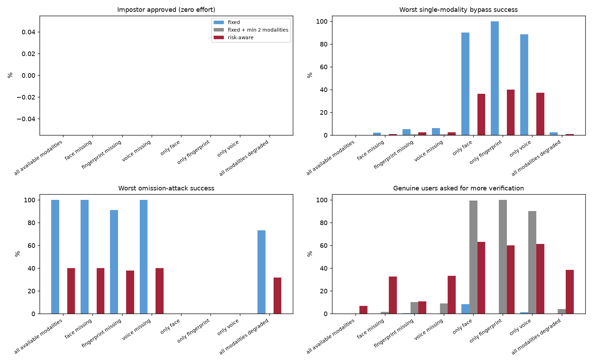

# Evaluation

Everything in this file was produced by the scripts in `backend/app/evaluation/` and can be regenerated. The full machine-written report with every table is `backend/reports/REPORT.md` (plots in `backend/reports/`, copied to `docs/figures/`). Numbers below are copied from it.

## What was audited and fixed

I went through the first version of the evaluation and found these problems. Each one was fixed and all experiments were re-run, so the numbers in this file replace the earlier ones.

| Problem in v1 | Effect | Fix |
|---|---|---|
| Impostor probes could come from subjects in the calibration half | Calibration identities leaked into the evaluation set | A trial is only used when both the template owner and the probe owner are in the same half (`select_in_half`). A test checks this. |
| Single calibration/evaluation split | No idea how much results depend on the split | 10 random splits, mean and standard deviation reported next to the primary split |
| Genuine probes were the next files in sorted order | For LibriSpeech these are consecutive utterances of one chapter, an easy same-session case | Genuine probes prefer a different folder than the enrollment files; the share that really was cross-session is reported (voice 38%, LFW has no session information, so 0%) |
| No uncertainty | "0.0%" looked like a result | Trial counts and Wilson 95% intervals; fusion intervals use the smallest score pool, not the number of resampled attempts |
| Fusion experiment only had zero-effort impostors | It could not show what risk-aware fusion is for | Added single-modality bypass and omission attacks (see below) and a fixed-threshold sweep |
| No ablation | The risk-aware gains might come from the simple rule "require two modalities" | Added a baseline "fixed threshold + at least 2 modalities" |
| Fusion crashed if a modality had no score file | Real bug in `run_fusion` | Fixed, covered by a test |
| NaN rates could be written into JSON | Invalid JSON for the browser | Rates are `None` when undefined, storage rejects NaN |
| Fitted calibration collapsed to a step when classes did not overlap | Every score became exactly 0 or 1 and fusion degenerated into voting | Scale is floored at 10% of the genuine/impostor mean gap (test added) |
| Fingerprint matcher: ratio 0.8 and 5 px RANSAC tolerance | Impostor pairs reached 22 inliers, and half-occluded probes were accepted by about 11% of impostors on synthetic data | Tuned to ratio 0.7 and 3 px on identities that are not used for reporting. In that tuning run the impostor maximum on clean prints fell from 22 to 8 inliers |

I also checked an idea that turned out wrong: that the identical oval outline of every synthetic print caused the false accepts. Giving each identity its own outline did not remove them (the matcher was the cause), but the generator now varies the outline anyway because a shared outline would be a confound.

Not fixed because it cannot be: SFace and ECAPA were trained on large public datasets and I cannot rule out that some LFW identities were in SFace's training data. LibriSpeech is disjoint from VoxCeleb.

## Protocol

**Per module** (`run_modality`). Dataset layout `<root>/<subject>/**/<sample>`.

- Only subjects with enough samples are used. Enrollment is the first N files (face 2, voice 3, fingerprint 1). Genuine probes never include an enrollment file. Impostor probes are random files of other subjects.
- Every trial goes through the real module once, including decoding, quality gates, embedding and scoring; latency is the whole call.
- Subjects are split into a calibration half and an evaluation half. The logistic calibration (center, scale) is fitted on the calibration half only. The evaluation half is scored at that fitted threshold. Primary split = seed 1, repeated for seeds 2 to 10.
- A threshold from a logistic fit is not the same as choosing a threshold for a target FAR. A bank would pick a target FAR first. I did not do that because the trial counts are far too small to estimate a 0.1% FAR.
- Inputs a module could not evaluate (no face, too short audio) are excluded from FAR and FRR and reported as the not-evaluable rate. That means FRR is conditional on the sample being usable, and the real failure-to-acquire cost is in the not-evaluable column.
- Reproducibility: seeded trial construction, a hash of the trial list (manifest), command line, library versions and the face model file hashes are stored with each run. A test checks that the same seed gives the same manifest and metrics.

**Fusion** (`run_fusion`). "Virtual multimodal users": no single dataset here has all three traits, so an attempt combines unrelated people's trials, which assumes independent modalities. Scenarios:

- genuine: a genuine trial for every modality
- zero-effort impostor: impostor trials everywhere
- single-modality bypass: the attacker beats one modality (a genuine-like score, as after a good spoof) and is an impostor on the others
- omission attack: the attacker beats one modality and submits only that one, leaving the rest blank

Each scenario is generated for each risk level with the same number of attempts (1000), and all policies score the same attempts. Overall figures weight the risk levels by an assumed mix (40% low, 30% medium, 20% high, 10% critical), which is invented. Everything is repeated 5 times with different seeds.

Policies: **fixed** (baseline A), **fixed + min 2 modalities** (ablation), **risk-aware** (proposed B). Thresholds are in `docs/IMPLEMENTATION.md`, the file `backend/policy.example.json` shows the format for overriding them, the active values are shown in the app on the Analytics page and returned by `GET /api/policy`.

## Results

### Individual modules

| Module | Data | Eval subjects | Genuine / impostor trials | EER | FAR (95% CI) | FRR (95% CI) | FAR over 10 splits | FRR over 10 splits | Not evaluable | Mean latency |
|---|---|---|---|---|---|---|---|---|---|---|
| Face | LFW funneled (real) | 127 | 283 / 420 | 0.45% | 0.50% (0.1 to 1.8) | 0.39% (0.1 to 2.2) | 0.25% ± 0.17 | 0.55% ± 0.33 | 6.7% | 14 ms |
| Voice | Mini LibriSpeech (real) | 13 | 65 / 53 | 0.00% | 0.00% (0.0 to 6.9) | 3.12% (0.9 to 10.7) | 1.37% ± 1.84 | 0.78% ± 1.10 | 1.7% | 884 ms |
| Fingerprint | **synthetic** | 50 | 150 / 196 | 0.00% | 0.00% (0.0 to 1.9) | 0.00% (0.0 to 2.5) | 0.00% ± 0.00 | 0.00% ± 0.00 | 0.0% | 29 ms |




How to read this:

- Face: 47 of 300 sampled LFW subjects could not be enrolled (no usable face under my gates), so the face result applies to usable photos. EER is under 1%, but the interval on FAR still reaches 1.8% and these are well-lit news photos.
- Voice: only 26 speakers exist in Mini LibriSpeech dev-clean-2, so 13 per half and only 53 usable impostor trials in the primary split. The across-split spread (FAR 1.4% ± 1.8%) is the more honest picture than the single 0.0%. The 3.1% FRR in the primary split is 2 genuine trials.
- Fingerprint: synthetic prints only. It shows the matcher separates rotated, shifted and noisy copies of the same generated pattern from other generated patterns. It says nothing about real fingerprints.

### Degraded inputs (single module, evaluation-half trials re-scored after the transformation)

| Module | Condition | Trials | FAR | FRR | Not evaluable |
|---|---|---|---|---|---|
| Face | mild blur (sigma 1.5) | 200 | 1.35% | 0.00% | 34.5% |
| Face | dim light (x0.4) | 200 | 0.00% | 0.00% | 68.0% |
| Face | strong blur, very dark, half resolution, 1/5 resolution | 200 each | n/a | n/a | 100% |
| Voice | noise 10 dB SNR | 60 | 0.00% | 13.79% | 6.7% |
| Voice | noise 0 dB SNR | 60 | 0.00% | n/a | 98.3% |
| Voice | truncated to 1 s | 60 | n/a | n/a | 100% |
| Fingerprint (synthetic) | half occluded | 150 | 0.00% | 18.03% | 7.3% |
| Fingerprint (synthetic) | heavy noise | 150 | 0.00% | 100% | 0% |

The quality gates refuse most degraded face and voice input instead of guessing, which is the intended safe behaviour but means those users would be asked to retry. The heavy-noise fingerprint case is a 100% false reject, so that matcher has no noise tolerance at all beyond mild levels. The LFW faces are only about 100 px wide, so the 80 px minimum face size also trips at half resolution.

### Fixed vs risk-aware fusion

Data: face (real), voice (real), fingerprint (**synthetic**). Because of the synthetic fingerprint scores and the assumed risk mix, this is a comparison of policy behaviour, not evidence of real-world accuracy. These numbers were produced with the current policy, where face and voice are the required core for high and critical payments and fingerprint is optional (see IMPLEMENTATION.md). Condition "all available modalities", overall (risk-mix weighted), 5 repeats of 1000 attempts per cell:

| Policy | FAR zero effort | FRR | Genuine asked for more | Worst bypass | Worst omission attack |
|---|---|---|---|---|---|
| Fixed | 0.00% | 0.06% | 0.0% | 0.1% | **100.0%** |
| Fixed + min 2 modalities | 0.00% | 0.06% | 0.1% | 0.0% | 0.0% |
| Risk-aware | 0.00% | 0.00% | 6.8% | 0.0% | **40.0%** |

Other conditions (full table in `backend/reports/REPORT.md`):

| Condition | Fixed: genuine asked for more / worst omission or bypass | Fixed + min 2 | Risk-aware |
|---|---|---|---|
| fingerprint missing (the normal case, it is optional) | 0.2% / omission 91.2% | 10.3% / 0% | 10.8% / 38.0% |
| voice missing | 0.0% / omission 100% | 9.1% / 0% | 33.2% / 40% |
| only face | 8.3% / bypass 90.1% | 99.4% / 0% | 63.2% / 36.4% |
| only voice | 1.4% / bypass 88.5% | 90.1% / 0% | 61.4% / 37.3% |
| all inputs degraded | 0.2% / omission 73.3% | 4.1% / 0% | 38.6% / 31.9% |




Per risk level (all modalities present), the risk-aware policy's friction is concentrated where it is meant to be: 2.7% for low, 3.7% for medium, 13.8% for high and 18.8% for critical payments.

A note on what changed: in an earlier version a critical payment needed all three modalities and the friction with everything present was 2.6%. Making fingerprint optional and requiring face and voice for high and critical payments raised it to 4.7%, because a missing or unusable face or voice sample (face was not evaluable on about 7% of trials) now sends a high-value payment to extra verification, while a missing fingerprint no longer does.

A second change came from the identity check (see [IDENTITY_VERIFICATION.md](IDENTITY_VERIFICATION.md)): every evaluated modality must now reach its own match line (calibrated score 0.50) at every risk level, so a clear "no match" from one modality cannot be outvoted by a strong score from another. Before, the low and medium bands tolerated a weak modality if the average was high. This raised the friction for genuine users with everything present from 4.7% to 6.8% (a genuine user whose face or voice scores just under their line is now asked for more verification instead of approved), and it removed the 0.1% worst bypass. Policy comparison on simulated attacks, not a measurement of real-world security.

### What this does and does not show

Does the risk-aware policy improve the security-usability trade-off? The honest answer is "it depends on the comparison":

- **Against the plain fixed threshold: yes, on the attack the baseline is weak against.** The fixed policy averages whatever modalities are present, so an attacker who beat one modality and left the others blank is approved 100% of the time at every risk level. Risk-aware stops this for medium, high and critical payments. The residual 40% is exactly the low-risk share of the assumed mix, because the low-risk band deliberately accepts a single modality. On degraded input the risk-aware policy rejects far fewer honest users (FRR 19.7% for fixed against 1.5%), at the price of asking 29% of genuine users for more verification.
- **Against a static "at least 2 modalities" rule: no clear win.** That rule blocks every omission attack and has less friction when all three modalities are present (0.1% against 6.8%). Risk-aware is only better where that rule is expensive: when a user can offer only one modality, the static rule sends 99% of genuine users to extra verification and the risk-aware policy sends 63%, and for low-risk payments it lets them through. The price is accepting single-modality attacks on low-risk payments. So risk-aware is a different point on the curve, not a dominating policy. Whether low-risk single-modality approval is acceptable is a business decision.
- The fixed-threshold sweep shows that raising the baseline threshold does not help against omission: even at 0.99 the success rate stays near 88% while 41% of genuine users are blocked.
- "Additional verification" counts as stopping an attack in these tables. A real attacker could still try to pass the extra step, which is not modelled, so the attack figures for policies with many extra-verification outcomes are optimistic.
- FAR is 0.00% almost everywhere because the underlying scores separate almost perfectly on these datasets. The intervals (up to 6.8% with the smallest pool of 53 impostor trials) are the real statement about what the data can support. The fusion differences in the FAR column are not meaningful; the omission and friction columns are, because they are determined by the policy rules.
- The thresholds were not tuned on these results. They are the same experimental values used from the start.

## Liveness checks

Source: `python -m app.evaluation.run_liveness` (stored as a run of kind `liveness`, also in `backend/reports/REPORT.md`). **No spoofing dataset** (CASIA-FASD, Replay-Attack, ASVspoof) could be downloaded, so none of this is a measurement against real presentation attacks.

### Face head-turn check (real detector, real LFW photos, simulated attacks)

250 people, thresholds yaw 0.25, parallax 0.15, step fraction 0.7. The thresholds were chosen from a table of pass rates over a grid of values on the same kind of data, so they are tuned on it, not held out.

| Scenario | Passed |
|---|---|
| Flat photo turned about a vertical axis in front of the camera (perspective warp, smooth 10-frame ramp, 4 angles) | 1 of 1000 (0.10%, 95% CI 0.0 to 0.6%) |
| Two real photos of the owner shown one after the other (frontal then turned the requested way) | 0 of 192 (CI 0 to 2.0%), all stopped by the abrupt-change rule |
| Real-turn proxy: different photos of one person that differ by a clear turn, parallax test only | 192 of 192 (CI 98.0 to 100%) |

Result codes for the tilt attack: 985 "no head turn", 12 "face lost", 2 "wrong direction", 1 passed.

What this does not show: the "real turn" row uses pairs of stills, so it checks the parallax rule on genuine 3D pose differences but not a smooth real turn through the whole check, and I cannot give a false-reject rate for honest users. The attacks are geometric simulations; a real printed photo has glare, bending and a visible edge, and a screen shows moire, none of which are modelled. A swap with the two photos blended or with intermediate images, a video, or a deepfake is not tested. The check has not been run with a webcam.

### Spoken-word check (real speech, real recognizer, content only)

130 real LibriSpeech utterances from 26 speakers. Challenge words were taken from each utterance's transcript (long words), because I cannot record people saying the project's own vocabulary. "Unrelated recording" means the challenge words are checked against a different speaker's utterance (650 pairs).

| Words required | Said, clean | Said, 10 dB noise | Said, 0 dB noise | Unrelated recording |
|---|---|---|---|---|
| 3 of 3 | 78.5% (70.6 to 84.7) | 53.8% (45.3 to 62.2) | 13.1% (8.3 to 19.9) | 0 of 650 (0 to 0.6%) |
| 2 of 3 | 95.4% (90.3 to 97.9) | 90.8% (84.6 to 94.6) | 48.5% (40.0 to 57.0) | 0 of 650 (0 to 0.6%) |

The first design required all three words, which would have rejected about one honest speaker in five on clean audio and almost half at 10 dB. The default is now 2 of 3. Three random words from the project vocabulary appeared in unrelated speech 0 of 3000 times (CI up to 0.1%). Words in continuous speech are harder to recognise than words said on their own, so isolated challenge words may do better, but I did not measure that. Voice cloning, text-to-speech and replay of recordings that happen to contain the words are not tested.

## How to reproduce

```bash
cd backend
# datasets are not in the repo; layout <root>/<subject>/<files>
python -m app.evaluation.run_modality --modality face  --root <lfw_funneled> --max-subjects 300 --enroll-samples 2 \
    --genuine-per-subject 3 --impostors-per-subject 8 --splits 10 --degraded-trials 200 --write-calibration
python -m app.evaluation.run_modality --modality fingerprint --synthetic --max-subjects 100 --splits 10 --degraded-trials 150
python -m app.evaluation.run_modality --modality voice --root <LibriSpeech/dev-clean-2> --max-subjects 40 --enroll-samples 3 \
    --genuine-per-subject 5 --impostors-per-subject 8 --splits 10 --degraded-trials 60 --write-calibration
python -m app.evaluation.run_fusion            # --policy-file other.json to test other thresholds
python -m app.evaluation.run_liveness --lfw <lfw_funneled> --speech <LibriSpeech/dev-clean-2>   # needs the speech model
pip install -r requirements-eval.txt && python -m app.evaluation.report
```

Datasets I used: LFW funneled (figshare file 5976015) and Mini LibriSpeech dev-clean-2 (openslr.org/resources/31). Each run stores its seed, command, library versions and trial-list hash in the `reproducibility` field, shown in `REPORT.md`. Everything ran on CPU only (8 cores). Face and fingerprint take a few minutes each; voice takes several minutes because ECAPA is slow on CPU (about 0.9 s per trial).

## Tests

`pytest` in `backend/` runs 234 tests. Unit and API tests use fake biometric modules for score control. Three integration tests (`-m integration`) run the real face and voice models on small fixtures and skip with a reason if a model is missing. The evaluation code has its own tests (metrics, trial construction without leakage, split separation, determinism, fusion simulation, end-to-end on synthetic fingerprints). Security tests are described in [SECURITY.md](SECURITY.md).
